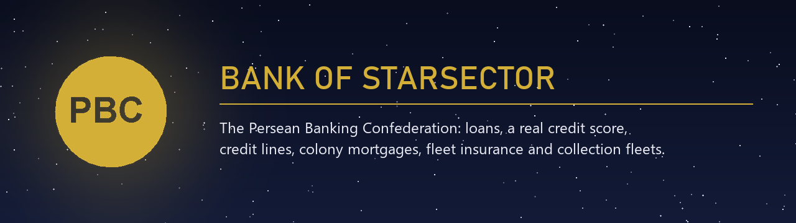

  

  
  
  
  
  
  

# Bank of Starsector

**A banking and economy mod for [Starsector](https://fractalsoftworks.com/).** Borrow money, build a real credit score, open a credit line, mortgage your colonies, insure your fleet, and invest in the war economy, all through the **Persean Banking Confederation**: a neutral faction that has kept the Sector's books since the Collapse.

And if you stop paying, the bank sends a fleet.

**[Download the latest release](https://github.com/TheAlanK/BankOfStarsector/releases/latest/download/BankOfStarsector.zip)** · [Features](#features) · [FAQ](#faq) · [Lore](LORE.md) · [Changelog](#changelog)

## Stories this mod creates

- You missed three installments. Somewhere in hyperspace, a **PBC Collection Fleet** is plotting a course to you. When it arrives, the commander hails you with an account number and a choice.
- You mortgaged your best colony to fund a war, then lost the war. The colony went into **receivership**, the Confederation **foreclosed**, and it was **auctioned to the Hegemony**. The bank wired you the surplus.
- Your credit score works like a **real FICO score**. You can't farm it by taking and repaying loans: the bureau only counts months paid on time.
- Your best destroyer died in a battle. **Fleet insurance** paid 60% of its value two days later. It wouldn't have, if you'd bought it last week.

## Quick start

1. [Download `BankOfStarsector.zip`](https://github.com/TheAlanK/BankOfStarsector/releases/latest/download/BankOfStarsector.zip) and extract it into `Starsector/mods/`.
2. Enable **Bank of Starsector** in the launcher and start a new game, or load an existing save (see the [FAQ](#faq)).
3. Open **Intel → Economy → PBC Banking Terminal** from anywhere, or visit a **Confederation branch office** at any PBC market.

No dependencies. Works with **Nexerelin**, **[NexusUI](https://github.com/TheAlanK/NexusUI)** and **LunaLib** when they are installed.

## Recommended companion mods

- **[NexusUI](https://github.com/TheAlanK/NexusUI)**: an external dashboard for Starsector. It opens live panels in their own windows, outside the game, so you can keep your fleet, colonies or finances on a second monitor while you play; it also serves live game data to other tools through a local API. With NexusUI installed, Bank of Starsector adds a **banking page**: amounts due, autopay, loans, credit line, insurance and your credit trend, with pay buttons. Requires LazyLib.
- **[Tripad Extension](https://github.com/TheAlanK/TripadExtension)**: a floating button bar for the campaign map. Mods add draggable buttons that you can arrange, lock together and toggle in LunaLib's settings. Install it with NexusUI and the dashboard button lives on that bar, next to your other mods' buttons. Requires LazyLib and LunaLib.

## Features

### Loans with monthly installments
Five loan tiers, from an Emergency Loan (50k) to a Sovereign Loan (5M), repaid in **monthly installments** (interest plus an even share of the principal). Installments appear in the vanilla **monthly income report** and are paid by **autopay**. You always get a one-month grace period before a payment is late. Every loan shows a **repayment schedule**, and the terminal and the branch office show the full terms (first installment, total interest, total repaid) **before you sign**.

Loan details: credit-builder loan, rates and the interest engine

- **Credit-builder loan**: for captains with no credit score or a low one (under 500), including during bankruptcy recovery. You borrow 10k–50k, but the money stays at the bank while you pay the installments (12 months, 1%/month fixed); when the loan is paid off, the money is yours. Each month paid on time builds your credit file. It doesn't count toward your loan limit, and if it defaults the bank simply keeps the deposit (no Collection Fleet), but the charge-off still goes on your credit report.
- **Interest engine**: each war between major factions adds +5% to loan rates, up to +25% (with Nexerelin this follows its live wars). Disrupted industries across the sector also make loans more expensive. Your credit bracket adjusts the rate (−15% / 0 / +20% / +50%).
- **Branch office**: apply for any amount with a slider, review the terms, then sign.

### A real credit score (FICO-style, 300–850)
Computed once a month from a **credit report**, like a real credit bureau: payment history 35%, amounts owed 30%, length of history 15%, new credit 10%, credit mix 10%. Every application is a hard inquiry, lateness is reported from 30 days and fades over 7 years, and there's no score until an account is 6 months old. The Credit tab shows your factors, the reasons behind your score, and a **12-month chart** that names what moved it each month.

Credit score details

- Your score bracket sets how many loans you can hold and adjusts your rates.
- Taking a loan and repaying it at once costs nothing in interest, but it doesn't build credit: it adds an inquiry and a young account, and no months of on-time payments.
- Credit-line utilization (balance ÷ limit) counts like on a real report: 1–10% is best, over 30% hurts, over 90% hurts a lot, and paying it down recovers the score at the next report.
- Defaults, charge-offs, repossessions and bankruptcy stay on file for years and fade with time.

### Revolving credit line
A **Confederation Credit Line** for scores of 500+ (limit 50k / 200k / 500k by bracket). Draw and repay freely. Each month end issues a statement with a minimum payment, and paying the statement in full means **no interest**. Six on-time statements raise your limit by 20%; a late payment cuts it.

Credit line details

- Minimum payment: interest + 1% of the balance, at least 1k (or the whole balance if smaller).
- Autopay pays the full statement by default; you can switch it to the minimum.
- The bureau sees the statement balance, so paying in full after the statement doesn't hide your utilization; paying down before it does.
- A default or bankruptcy closes the line to new draws.

### Colony mortgages, receivership, foreclosure and auctions
Pledge a colony (size 4+) for up to **60% of its appraised value** at a 25% lower rate. The appraisal counts development, structures (with improvements, AI cores and special items), natural resources and traits, a year of income, and hazard. Default, and the colony goes into **receivership**: all its income goes to the bank. With Nexerelin, 60 days later the PBC **forecloses by force** and **auctions the colony to a major faction**. The Confederation never keeps territory.

Foreclosure details

- The colony shows a *PBC Lien* condition while it secures a loan, and *PBC Receivership* (−3 stability) after a default.
- Foreclosure (Nexerelin only): the PBC turns hostile and sends an invasion from its largest market, then another every 60 days if one fails.
- Auction: every major faction not hostile to the PBC bids around the appraisal, more if it has territory nearby or good relations with the PBC. The highest bidder pays the second-highest bid (never under 70% of the appraisal). The price pays your loan, **any surplus is returned to you**, any shortfall stays owed, and relations go back to normal.
- Paying the amount due at any point lifts receivership and ends the foreclosure.
- Abandoning a pledged colony makes the whole loan due at once; if another faction captures it, the loan continues unsecured.

### Fleet insurance
House Varenne's underwriters insure every ship in your fleet. **Standard** pays 60% of a lost ship's base value (10k deductible per ship); **Comprehensive** pays 80% (5k deductible). The premium follows your fleet's value, your credit score (as real insurers use credit-based insurance scores), your recent claims and the war surcharge.

Insurance details

- Ships lost in battle are paid two days later, after the post-battle recovery: a recovered ship is no loss.
- No claims in a new policy's first 30 days, nor for ships that joined the fleet less than 30 days before the loss.
- Payouts are capped at half the insured value per month.
- An unpaid premium suspends the cover; a second one cancels the policy.

### Investments and the sovereign debt market
Savings accounts, government bonds, commodity futures, venture funds and military contracts, with **real-world long-run returns and risk**. Major factions **borrow from the Confederation to fund their wars** and repay in peace: bonds pay more when sovereign debt is high, military contracts pay more in wartime, commodity futures gain from shortages, and if an indebted faction collapses (Nexerelin), it defaults and bonds take a haircut.

Expected returns and where they come from

| Product | Expected return per year | Volatility per year | Real-world reference |
|---|---|---|---|
| Savings account | 3% | ~0 (never loses money) | 3-month T-bills 1928–2025: 3.4%/yr |
| Government bonds | 4.5% (+ up to 2% when sovereign debt is high) | 7.9% | 10-year US Treasuries 1928–2025: 4.5%/yr, 7.9% s.d. |
| Commodity futures | 4% (+ shortages) | 18% | Commodity futures indices: low single-digit returns, 14–23% volatility |
| Venture fund | 12% | 35% | Venture capital net IRRs ~10–15%; US small caps 1928–2025: 12.0%/yr, 38% s.d. |
| Military contract | 9% (+ up to 5% in wartime) | 18% | Defense contractors trade like stocks: S&P 500 1928–2025 10.0%/yr, 19.4% s.d. |

Stock, bond and bill figures are computed from Aswath Damodaran's [historical returns data](https://pages.stern.nyu.edu/~adamodar/New_Home_Page/datafile/histretSP.html) (NYU Stern). Each month's result is drawn around the expected return, so risky products can lose money in a bad year. Investments never out-earn the cheapest loan, so borrowing to invest doesn't pay. Want richer returns? Raise `investmentReturnMultiplier` in `bos_settings.json` or LunaLib.

### Debt collection fleets
Debt collection escalates by how many days a payment is overdue:

| Days overdue | What happens |
|---|---|
| 1 | Payment reminder |
| 31 | Penalty interest (+50% per month overdue), and new loans are suspended |
| 61 | A **Collection Fleet** is dispatched to hunt you down |
| 90 | **Default**: the bank seizes your investments, then garnishes 30% of your colony income every month |

When the Collection Fleet reaches you, its commander hails you. You can pay the amount due, settle the whole debt, surrender a ship as collateral (credited at 60% of its value), stall for time, or refuse and fight. Destroying a collection fleet doesn't clear the debt: a fleet 1.5× stronger follows 30 days later. Paying what you owe at any time cures the loan and recalls the fleet.

### Bankruptcy
Available once a loan has defaulted, or when your debt exceeds 3× your monthly colony income. Filing cuts your debt by 80% and restructures it, liquidates your investments at 50%, puts a 10-year public record on your credit report, costs relations with the PBC and applies a colony income stigma. Loans are locked for 24 months (except the credit-builder loan), investing for 12.

### The Persean Banking Confederation
A full neutral faction with the **Aurum** star system (Bullion, Vault and Ledger Station), a powerful defensive navy, custom fleets (Security Details, Enforcement Fleets, Confederation Task Forces) and a **branch office** at every PBC market. Read its history, charter and relations with every faction in **[LORE.md](LORE.md)**.

### Mod integration
- **Nexerelin**: live wars drive interest rates, foreclosure invasions, market transfers after auctions, sovereign defaults. In a Nexerelin random sector, Nexerelin places the PBC markets.
- **[NexusUI](https://github.com/TheAlanK/NexusUI)**: a banking dashboard (amounts due, autopay, loans, credit line, insurance, credit trend) with pay/autopay buttons; the data is also exposed to NexusUI's data bridge as `pbc_banking`.
- **LunaLib**: in-game settings menu and version checker (you get an update notice when a new release is out).

## FAQ

**How do I get a loan in Starsector with this mod?**
Open **Intel → Economy → PBC Banking Terminal** (works anywhere), go to the Loans tab and pick a loan; or visit a PBC market and choose **"Visit the Confederation branch office"**. The money goes straight to your credits.

**Can I add Bank of Starsector to an existing save?**
Yes. The banking terminal, loans, credit score, credit line, insurance and investments work right away. The Aurum system and the PBC branch offices are only created in a new game.

**Can I remove it from a save?**
No. Like most mods that keep campaign data, removing it breaks the save.

**Is it compatible with Nexerelin?**
Yes, and it uses Nexerelin when it's there: wars, foreclosure invasions, auctions and sovereign defaults follow the live Nexerelin sector. Without Nexerelin everything works except foreclosure by force (colonies stay in receivership).

**Can I farm the credit score by taking and repaying loans?**
No. The score only rises with months paid on time; instant loans add hard inquiries and young accounts, which lower it.

**Where is the bank's money? Where is the bank?**
The Persean Banking Confederation lends from its own reserves. Its headquarters is the Aurum system, it has a branch office at every PBC market, and the terminal is available anywhere in Intel.

**Does it cause lag?**
It shouldn't. Since 0.3.1 the sector-wide numbers are computed once per game day and the NexusUI dashboard only refreshes quickly while it's open, so it stays light even with large mod lists.

**Does it work in Portuguese?**
Yes: English and Brazilian Portuguese (automatic by system language, or set it in LunaLib or `bos_settings.json`).

**Found a bug or have an idea?**
[Open an issue](https://github.com/TheAlanK/BankOfStarsector/issues/new/choose). Got a good story (a foreclosure, an auction, a collection fleet ambush)? Share it in [Discussions](https://github.com/TheAlanK/BankOfStarsector/discussions).

## Configuration
Every number can be changed in `data/config/bos_settings.json`, and other mods can merge their own values into it. With **LunaLib**, the main settings and the language can also be changed in-game (LunaLib settings menu); those values take precedence over the JSON.

## Languages
English and Brazilian Portuguese. `language` = `auto` follows the system language; set `en` or `pt_BR` in `bos_settings.json` or LunaLib. Translations live in `data/strings/bos_strings_<lang>.json`; any missing key falls back to English. New translations are welcome.

## Installation
1. Download [the latest release](https://github.com/TheAlanK/BankOfStarsector/releases/latest).
2. Extract it to your `Starsector/mods/` folder.
3. Enable "Bank of Starsector" in the launcher.

Saves from earlier versions load fine (every release is checked against the previous version's save format). Requires Starsector 0.98a-RC8. No required dependencies; Nexerelin, NexusUI and LunaLib are optional.

## For modders and contributors
- **Building**: `build.ps1` (PowerShell) or `build.bat`. To compile you need the game's `starsector-core` jars plus `ExerelinCore.jar` and `NexusUI.jar`, because the compatibility bridges are compiled against them. At runtime those classes are only loaded when the matching mod is enabled.
- **Testing**: `test.ps1` builds the jar and runs a replay of Starsector's script sandbox rules over every referenced class, a link check against the game's jars on the game's JRE, a format-string safety check, a translation-table check, a save-compatibility check (every field the mod writes into saves is compared with `tests/save-fields.baseline`; see [docs/SAVE_COMPAT.md](docs/SAVE_COMPAT.md)), and a month-by-month simulation of the whole bank. `test.ps1 -Smoke` also launches the real game directly, waits for the main menu and scans `starsector.log` for errors from this mod.
- See [CONTRIBUTING.md](CONTRIBUTING.md).

## Changelog

### 0.3.2-beta
- **Changed:** investment returns follow real long-run asset classes instead of 1–8% a month: savings 3%/yr, government bonds 4.5%, commodity futures 4%, venture fund 12%, military contracts 9%, each with realistic volatility. Wartime, sovereign-debt and shortage effects are realistic too. A new `investmentReturnMultiplier` setting lets you raise them.

### 0.3.1-beta
- **Performance:** fixes stuttering with large mod lists. The war surcharge and market disruption are computed once per game day (they scanned every market several times a second), and the NexusUI dashboard only refreshes quickly while it is open.

### 0.3.0-beta
- **New:** credit-builder loan, the realistic way to start (or rebuild) a credit file.
- **New:** fleet insurance (Standard and Comprehensive policies, credit-based premiums, claims after post-battle recovery).
- **New:** colony-secured loans with receivership, Nexerelin foreclosure and auction of the colony to a major faction.
- **New:** repayment schedule per loan, and a 12-month score chart that explains each change (also in NexusUI).
- **New:** loan and investment quotes before signing (terminal confirmation and branch office), and loans/investments for any amount at the branch office.
- **New:** revolving credit line with monthly statements, minimum payments, a grace period, automatic limit increases, and utilization in the credit score. The Sovereign loan is no longer called a "credit line".
- **Fix:** a default is put on the credit report when it happens, so a seizure that settles it before month end no longer hides it; a charged-off loan no longer adds a new late mark every month.
- **Internal:** a test now fails the build if a change would break loading existing saves ([docs/SAVE_COMPAT.md](docs/SAVE_COMPAT.md)).

Older versions (0.1.x – 0.2.1)

### 0.2.1-beta
- **New:** Persean Banking Confederation lore ([LORE.md](LORE.md)), condensed into the in-game faction and planet descriptions (English and pt-BR).

### 0.2.0-beta
- **New:** Brazilian Portuguese translation (automatic by system language), translatable faction/planet descriptions.
- **New:** LunaLib settings menu and version checker file; release zip now has a stable `BankOfStarsector.zip` asset and includes `graphics/`.
- **Fix:** the NexusUI page read game state from NexusUI's refresh thread; it now renders snapshots published from the game thread and sends actions through NexusUI's command queue.
- **New:** test suite (`test.ps1`) including an in-game smoke test.
- **Fix:** the Nexerelin and NexusUI integrations never worked. Starsector's script class loader (`com.fs.starfarer.loading.scripts.B`) rejects every `java.lang.reflect` class with *"File access and reflection are not allowed to scripts"*. Both now use direct calls through bridge classes, with no reflection at all.
- **New:** monthly installments, autopay through the vanilla monthly report, a one-month grace period, and past-due tracking.
- **New:** income garnishment is now actually applied in default, and the garnished money pays down the debt. (It was never triggered before, and the old income multiplier never reached the bank.)
- **New:** the Collection Fleet hails you with real choices (pay, settle, surrender a ship, stall, refuse). It survives save/load, and destroying it brings a stronger fleet.
- **New:** Confederation branch office at PBC markets.
- **New:** `data/config/bos_settings.json`.
- **New:** credit score recovers during bankruptcy, and missed payments are penalized.
- **New:** asset seizure on default (investments held at the bank, then colony income). Loans closed this way get the SEIZED status.
- **New:** sovereign debt simulation for NPC factions, tied to government bond yields and sovereign defaults (this code existed but was never called).
- **New:** bankruptcy now asks for confirmation; the terminal shows the loan and investment lockout timers and the real reason a loan type is unavailable.
- **Fix:** every intel icon pointed to graphics/icons/intel/credits.png, which does not exist in the game. They now use registered sprites and the PBC crest.
- **Fix:** in a Nexerelin random sector the PBC got both Nexerelin's markets and the Aurum system.
- **Fix:** a collection fleet that could not spawn (no PBC market left) blocked collection forever; it now retries later.
- **Fix:** the credit bracket descriptions didn't match the minimum scores of each loan type.
- **Change:** LazyLib is no longer a dependency (it was never used).
- **Fix:** account IDs reset to 1 after every load, so loans could collide. A persistent counter replaces it, and old saves are migrated.
- **Fix:** collection notices piled up forever. They now end when superseded or resolved.
- **Fix:** collection phase 2 doubled the loan rate permanently. Penalty interest now applies only while overdue.
- **Fix:** the "disrupted" market condition doesn't exist in vanilla, so the investment disruption modifier was always 0. It now reads `Industry.isDisrupted()`.
- **Fix:** the interest rate now uses the credit bracket modifier that the terminal displays.

### 0.1.x
- Initial releases.

## License

MIT License. If the bank hasn't foreclosed on you yet, consider giving the repo a star.
